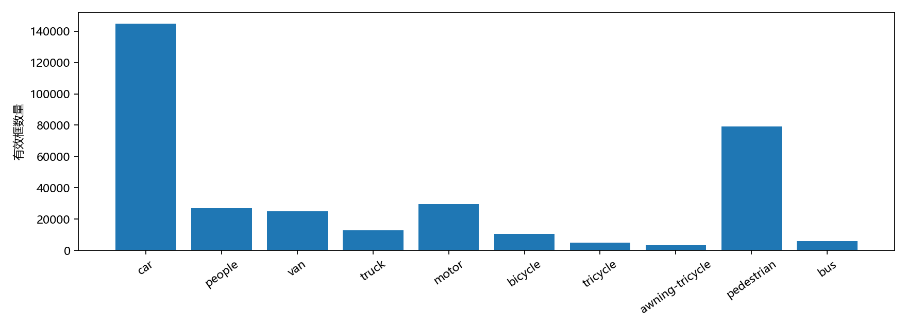
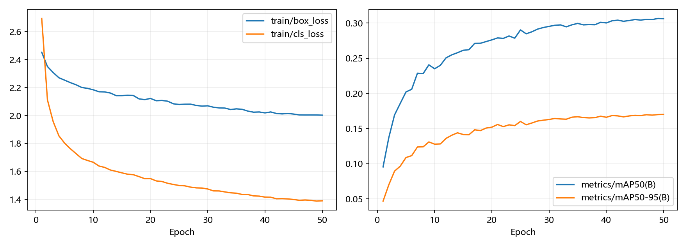
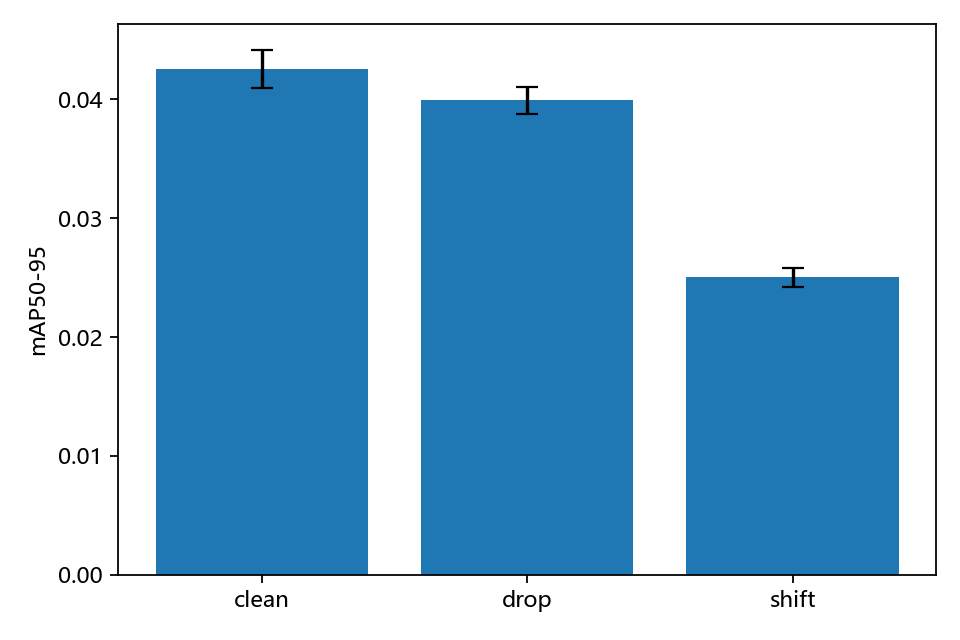
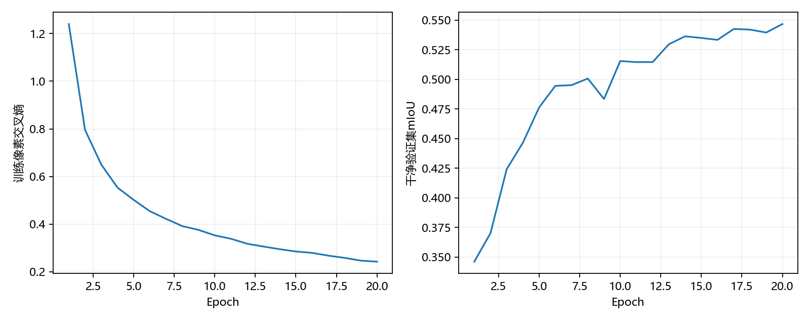
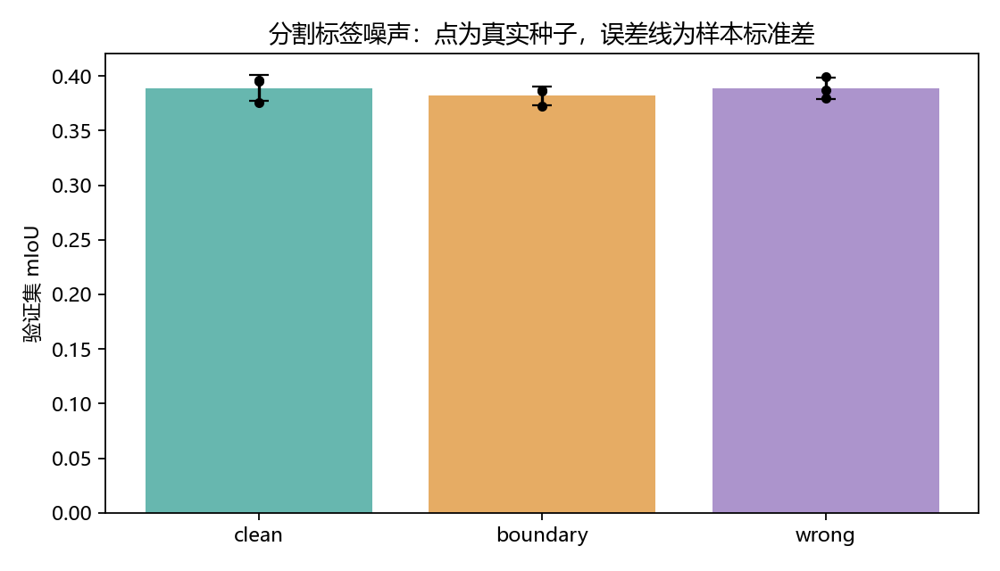
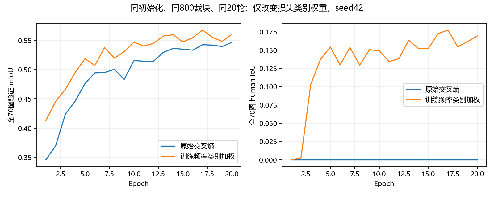

# DroneVision Lab：无人机视觉模型训练与数据质量影响研究

报告生成时间：2026-11-07T01:48:51.605485+08:00。本报告按真实文件自动更新；进行中的数值不可作为最终结论。

> 公开版说明（2026-11-12）：本文由项目内部的报告脚本在 2026-11-07 生成。公开版删掉了指向内部交付文件的链接，并补充了第 5.1 节 test-dev 留出集评测。文中提到的 runs/ 下的权重、预测图和视频不随仓库发布，数据集需按 README 自行下载。

## 1. 研究背景与范围

本项目是独立的个人研究，只使用公开数据集，与任何公司或机构的内部项目无关。目标是用公开无人机数据，将人工标注检查转变为可量化的训练与评测实验。研究问题包括定位偏移、漏标、时序补齐和分割边界噪声对性能的影响，不预设清洗或平滑一定有效。

## 2. 数据来源、划分和质量

VisDrone-DET 保留官方 train/val/test-dev 划分；只有 train 参与参数更新，val 用于固定口径验证，test-dev 不调参。原始 ZIP 和标注保留，噪声数据另存。来源和许可见 [THIRD_PARTY.md](../THIRD_PARTY.md)。

| 划分 | 图像 | 有效框 | 忽略框 | 非法框 | 640下小目标占比 |
| --- | --- | --- | --- | --- | --- |
| train | 6471 | 343204 | 10345 | 1 | 0.9054 |
| val | 548 | 38759 | 1410 | 0 | 0.9244 |
| test-dev | 1610 | 75102 | 2445 | 0 | 0.9319 |

小目标定义为框面积小于 32×32；640 下的比例按保持长宽比缩放估算，不代表 COCO 官方面积分组。训练器另外会删除完全重复标签，原始计数与训练器有效计数可能略有不同。

DET train/val 的完全相同编码图像SHA256交集为 0。这不能排除相似场景或公共预训练数据重叠。

独立的MOT训练数据已完成ZIP全CRC和标注审计：56段序列、24201帧、1169359行标注，其中五个MOT目标类别有效行826697。归档完整保留，按需解码有界样例，避免再解压全部帧；GT示例视频不冒充模型预测。详见 [mot-train-audit.json](mot-train-audit.json)。

UAVid：200 张训练图、70 张验证图；按序列隔离，clutter 类参与训练与评测。质量明细见 [uavid-data-quality.json](uavid-data-quality.json)。

## 3. 模型、硬件与环境

实际设备：NVIDIA GeForce RTX 5060 Ti，计算能力 [12, 0]，PyTorch 2.9.1+cu128，CUDA runtime 12.8，Python 3.12.10。已进行 5 次 CUDA 反向传播与 SGD 更新，损失从 0.204659 降至 0.199617，最大参数变化 0.00053297。这项验证只证明 GPU 训练环境可用。完整记录见 [environment.json](environment.json)。

检测模型采用 YOLO26n COCO 预训练权重，Ultralytics 8.4.14。采用固定 AdamW 优化器、lr=0.001、AMP、seed=42、640 输入；禁用 mosaic 以便控制噪声实验的数据处理。正式训练 batch=16、50 epochs，每轮验证。依赖锁定见 [requirements-lock.txt](../requirements-lock.txt)。初始权重、Git 版本、数据配置及检查点哈希记录在各训练 JSON 中。

## 4. 实验设计与公平性

P0：32 张图、2 轮冒烟后，6,471 张官方训练图完成正式微调。P1：固定 256 张训练图，干净/中心偏移/漏标三个标签版本，每组 20 轮，训练随机种子 42、43、44；同种子共享初始预训练权重，噪声实现固定为 seed=42。偏移为每框 x/y 独立均匀 ±20% 宽/高，漏标为每框 30% 概率删除。所有模型在同一 548 张干净 val 上评测。

预训练 COCO 模型没有 VisDrone 的全部类别，不能直接比较其 COCO mAP 与微调后的 10 类 mAP。共享口径合并 pedestrian/people 为 human，仅比较 human、bicycle、car、truck、bus、motorcycle 六类；其他真值和忽略框作为 crowd 区域处理。完整 10 类实验独立报告。自定义评测采用 COCO 101 点 AP、IoU=.50:.95、maxDet=500；P/R 为 conf=.25、IoU=.5 的微平均。此协议不是官方 VisDrone 排行榜分数，忽略区域处理与官方实现存在差异。Ultralytics 训练曲线指标也不与自定义指标混算。

## 5. 检测训练与评测结果

冒烟训练已完成：耗时 37.9 秒，CUDA 峰值分配 1.65 GiB，骨干最大参数变化 0.00012207，权重已重新加载。

正式50轮训练已完成：72.56分钟，CUDA峰值allocated=5.79 GiB、reserved=9.76 GiB，骨干最大参数变化=0.122467。allocated是实际张量分配，reserved含缓存，二者不等于桌面其他进程占用。

正式训练当前记录到第 50 / 50 轮。当前状态：completed。最近一轮 Ultralytics mAP50=0.3064，mAP50-95=0.1701。这是验证过程记录；最终模型以独立评测和 best.pt 为准。

| 实验 | 类别口径 | Precision | Recall | mAP50 | mAP50-95 |
| --- | --- | --- | --- | --- | --- |
| baseline-common | common | 0.8501 | 0.1345 | 0.1636 | 0.0920 |
| trained-common | common | 0.7770 | 0.4056 | 0.3764 | 0.2047 |
| trained-full | visdrone | 0.6991 | 0.3762 | 0.3005 | 0.1640 |

全十类独立评测明细（数值0到1）：

| 类别 | AP50 | AP50-95 | Precision@0.25 | Recall@0.25 |
| --- | --- | --- | --- | --- |
| pedestrian | 0.3435 | 0.1403 | 0.6510 | 0.2596 |
| people | 0.2662 | 0.0892 | 0.6353 | 0.1580 |
| bicycle | 0.0810 | 0.0299 | 0.3881 | 0.0606 |
| car | 0.7113 | 0.4607 | 0.7439 | 0.6661 |
| van | 0.3264 | 0.2180 | 0.5762 | 0.2699 |
| truck | 0.2651 | 0.1681 | 0.6000 | 0.2120 |
| tricycle | 0.1764 | 0.0908 | 0.5226 | 0.1215 |
| awning-tricycle | 0.0939 | 0.0548 | 0.3853 | 0.0789 |
| bus | 0.3894 | 0.2530 | 0.5802 | 0.3745 |
| motor | 0.3514 | 0.1348 | 0.6902 | 0.2198 |

原生小目标面积分组AP为 0.0817；与整体AP均采用同一自定义COCO式协议，不能冒称官方挑战分数。

共享六类mAP50-95差值为 +0.1128。固定conf=.25时，Precision从 0.8501 变为 0.7770，Recall从 0.1345 变为 0.4056。不能据此声称所有指标同时提高；这是该阈值与公开验证集上的精确率/召回率权衡。

### 5.1 test-dev 留出集一次性评测（2026-11-12 补充）

用同一个 best.pt、同一个评测器，在 VisDrone2019-DET test-dev（1610 张）上每个模型评一次。评测器只加了 `--split` 参数（默认 val），评测逻辑没变。跑 test-dev 之前，先用改后的评测器在 val 上复跑 trained-full：mAP50、mAP50-95、Precision、Recall 都与上表完全一致，10 类 TP/FP/FN 也逐项相同。

| 实验 | 类别口径 | val mAP50 | test-dev mAP50 | val mAP50-95 | test-dev mAP50-95 | test-dev Precision | test-dev Recall |
| --- | --- | --- | --- | --- | --- | --- | --- |
| baseline-common | common | 0.1636 | 0.0777 | 0.0920 | 0.0409 | 0.7833 | 0.0652 |
| trained-common | common | 0.3764 | 0.3235 | 0.2047 | 0.1776 | 0.7354 | 0.3535 |
| trained-full | visdrone | 0.3005 | 0.2514 | 0.1640 | 0.1360 | 0.6500 | 0.3386 |

- 微调带来的提升在 test-dev 上仍然成立：共享六类 mAP50-95 从 0.0409 升到 0.1776。
- test-dev 整体低于 val：十类 mAP50-95 从 0.1640 降到 0.1360，原生小目标 AP 从 0.0817 降到 0.0594。best.pt 是按 val 选出的，val 数字本身偏乐观；test-dev 的小目标比例也略高（缩放到 640 后为 0.9319，val 为 0.9244）。这两个因素没有拆开。
- 十类 AP50-95 降幅最大的是 pedestrian（0.1403→0.0801）、people（0.0892→0.0400）和 motor（0.1348→0.0835）；bus（0.2530→0.2984）、truck（0.1681→0.1694）和 awning-tricycle（0.0548→0.0652）没有下降。
- test-dev 的标注是公开的。这是项目留出、从未用于训练或调参的测试集上的一次性评测，不是官方挑战赛（test-challenge）的盲测；每个模型只评一次，没有据此调参。记录见 testdev-*-evaluation.json 和 valrepro-trained-full-evaluation.json。

## 6. 标注自动化与视频质量

固定 MOT-val 前三个序列，各取 120 帧及最多 4 条持续具有有效框标注的轨迹；优先包含遮挡，首帧框面积≥100。样例包含首帧已遮挡的目标，不代表随机或最优提示样本。仅评估中间帧，避免提示帧带来虚高。插值使用首尾真值，SAM2.1 tiny 使用首帧框提示，检测跟踪无需后续人工真值。SAM2 掩码转为紧致框再与 MOT 框比，不能据此宣称掩码边界准确；可见掩码的紧致框与公开遮挡目标框的语义也可能有差异。比较中心误差、宽高误差、框 IoU、丢失率和加速度误差；IDF1、MOTA、ID switches、fragmentations 只用于检测跟踪任务，HOTA 未实现则明确不报告。

跨任务来源审计：

| sequence | frames | exact_encoded_image_matches_DET_train | exact_encoded_image_matches_DET_val | DET_train_same_leading_flight_identifier | DET_val_same_leading_flight_identifier |
| --- | --- | --- | --- | --- | --- |
| uav0000086_00000_v | 120 | 0 | 0 | 0 | 5 |
| uav0000117_02622_v | 120 | 0 | 0 | 0 | 5 |
| uav0000137_00458_v | 120 | 0 | 0 | 6 | 0 |

航次编号相同说明可能存在同源场景，不等于证明帧完全相同。第三段MOT视频与6张DET训练图共享航次编号，前两段与DET验证图共享编号。因此这些视频指标是本地辅助标注诊断，不是严格未见场景泛化评测或官方VisDrone MOT挑战成绩；公共模型预训练数据的重叠也未被证明不存在。

| 序列 | 方法 | 目标数 | 平均框IoU | 缺失比例 |
| --- | --- | --- | --- | --- |
| uav0000086_00000_v | linear | 4 | 0.1585 | 0.0000 |
| uav0000086_00000_v | log-size | 4 | 0.1584 | 0.0000 |
| uav0000086_00000_v | sam2 | 4 | 0.5481 | 0.0000 |
| uav0000086_00000_v | bytetrack | 4 | 0.0523 | 0.8008 |
| uav0000086_00000_v | botsort | 4 | 0.0377 | 0.9216 |
| uav0000117_02622_v | linear | 4 | 0.0152 | 0.0000 |
| uav0000117_02622_v | log-size | 4 | 0.0152 | 0.0000 |
| uav0000117_02622_v | sam2 | 4 | 0.4217 | 0.0000 |
| uav0000117_02622_v | bytetrack | 4 | 0.0000 | 1.0000 |
| uav0000117_02622_v | botsort | 4 | 0.0000 | 1.0000 |
| uav0000137_00458_v | linear | 4 | 0.2923 | 0.0000 |
| uav0000137_00458_v | log-size | 4 | 0.2918 | 0.0000 |
| uav0000137_00458_v | sam2 | 4 | 0.7154 | 0.1165 |
| uav0000137_00458_v | bytetrack | 4 | 0.6804 | 0.2352 |
| uav0000137_00458_v | botsort | 4 | 0.6918 | 0.2288 |

所有有效五类目标的完整检测跟踪指标（不同于上面的四条提示轨迹子集）：

| 序列 | 方法 | MOTA | IDF1 | ID切换 | 轨迹片段 | 误检 | 漏检 |
| --- | --- | --- | --- | --- | --- | --- | --- |
| uav0000086_00000_v | bytetrack | 0.4358 | 0.5953 | 35 | 65 | 680 | 964 |
| uav0000086_00000_v | botsort | 0.4405 | 0.6035 | 40 | 70 | 683 | 942 |
| uav0000117_02622_v | bytetrack | 0.1563 | 0.3117 | 153 | 183 | 1022 | 2975 |
| uav0000117_02622_v | botsort | 0.1990 | 0.4764 | 62 | 208 | 1340 | 2538 |
| uav0000137_00458_v | bytetrack | 0.4104 | 0.6413 | 71 | 147 | 1300 | 2134 |
| uav0000137_00458_v | botsort | 0.4039 | 0.6533 | 62 | 166 | 1411 | 2071 |

各方法输入真值预算不同，不作同等输入成本下的算法优劣排名。seconds字段包含模型加载、预处理和方法内部输出处理；MOT方法还含指标计算，SAM2含掩码视频导出，不能当纯GPU推理FPS横比。演示视频统一按15fps编码，仅为播放速度。

可追溯输出：[video-results.json](video-results.json) 与 runs/video 下的逐帧预测、提示协议、掩码和 mp4。

关键帧间距敏感性（同12条轨迹、固定共同非提示评测帧）：

| gap_frames | provided_GT_boxes | evaluated_unprompted_boxes | mean_IoU | center_error_pixels | raw_predicted_center_acceleration_pixels |
| --- | --- | --- | --- | --- | --- |
| 10 | 156 | 1284 | 0.8047 | 6.7432 | 0.3627 |
| 30 | 60 | 1284 | 0.6135 | 21.8802 | 0.0739 |
| 60 | 36 | 1284 | 0.4375 | 41.5242 | 0.0315 |
| 119 | 24 | 1284 | 0.1585 | 85.8182 | 0.0000 |

本实验排除了所有间距条件提示帧的并集，保证评测帧完全相同。不同间距的人工框预算不同，不能把精度差异解释为同等输入下某算法更优；但可检验平滑程度与框准确性是否一致。

## 7. 数据质量对照实验

| 标签版本 | 原始框 | 保留框 | 实际漏标比例 | 配对框IoU | 平均中心偏移像素 |
| --- | --- | --- | --- | --- | --- |
| clean | 14271 | 14271 | 0.0000 | 1.0000 | 0.0000 |
| shift | 14271 | 14271 | 0.0000 | 0.6904 | 6.0096 |
| drop | 14271 | 9967 | 0.3016 | 不适用 | 不适用 |

以上为相对原始公开标注测得的标签干预量；定位质量与覆盖率是不同维度，不能随意压成一个总质量分。噪声组只在最后一轮验证，三组采用同样规则。

| seed | variant | Precision | Recall | mAP50 | mAP50-95 |
| --- | --- | --- | --- | --- | --- |
| 42 | clean | 0.5649 | 0.1684 | 0.0861 | 0.0429 |
| 42 | shift | 0.5520 | 0.0533 | 0.0648 | 0.0241 |
| 42 | drop | 0.6948 | 0.1025 | 0.0820 | 0.0403 |
| 43 | clean | 0.5894 | 0.1608 | 0.0865 | 0.0439 |
| 43 | shift | 0.6139 | 0.0480 | 0.0666 | 0.0256 |
| 43 | drop | 0.7124 | 0.0985 | 0.0815 | 0.0408 |
| 44 | clean | 0.5924 | 0.1595 | 0.0818 | 0.0408 |
| 44 | shift | 0.6126 | 0.0536 | 0.0660 | 0.0254 |
| 44 | drop | 0.7277 | 0.0835 | 0.0790 | 0.0387 |

误差线为训练随机种子间样本标准差，不代表跨数据集泛化范围。

shift 相对 clean 的配对 mAP50-95 差值均值为 -0.0175，基于 3 个种子的 t 区间约 [-0.0222, -0.0129]。样本量很小，不足以推断所有标注场景。

drop 相对 clean 的配对 mAP50-95 差值均值为 -0.0026，基于 3 个种子的 t 区间约 [-0.0039, -0.0013]。样本量很小，不足以推断所有标注场景。

## 8. 语义分割与分割噪声

SegFormer-B0 使用 ImageNet 预训练编码器和新建 8 类头，像素交叉熵监督。训练图先固定抽取 4 个 1024 原生裁块，缩放到512；验证图最长边1024输入，logits 上采样至原生掩码统计 IoU。它是本项目的资源受限协议，不可直接对比论文原生高分辨率/滑窗分数。干净、边界扰动、局部改背景三组共享固定40张源图与初始化，各10轮；边界扰动在7像素宽邻域内用±3像素平移掩码替换，局部错误为512裁块中128×128区域改为clutter。

| 实验 | mIoU | 像素准确率 | 耗时秒 | 峰值GiB |
| --- | --- | --- | --- | --- |
| seg-full-20 | 0.5466 | 0.8301 | 2012.7721 | 2.6918 |
| seg-noise-clean | 0.3756 | 0.7368 | 236.5152 | 2.7396 |
| seg-noise-boundary | 0.3720 | 0.7365 | 236.4137 | 2.7396 |
| seg-noise-wrong | 0.3795 | 0.7441 | 235.9418 | 2.7396 |

实际掩码干预量：

| 版本 | 总体改动像素比例 | human类改动比例 | moving-car类改动比例 |
| --- | --- | --- | --- |
| clean | 0.0000 | 0.0000 | 0.0000 |
| boundary | 0.0345 | 0.3033 | 0.1249 |
| wrong | 0.0522 | 0.0853 | 0.0418 |

这些数值测量标签变化，不是模型分割成绩；小类别的相对标注损伤可能显著高于总体比例。

类别级IoU：

| 实验 | clutter | building | road | tree | low-vegetation | moving-car | static-car | human |
| --- | --- | --- | --- | --- | --- | --- | --- | --- |
| seg-full-20 | 0.5330 | 0.8674 | 0.6965 | 0.7153 | 0.6426 | 0.4793 | 0.4388 | 0.0000 |
| seg-noise-clean | 0.3894 | 0.8033 | 0.5095 | 0.5628 | 0.5424 | 0.0145 | 0.1825 | 0.0000 |
| seg-noise-boundary | 0.3919 | 0.8011 | 0.5034 | 0.5666 | 0.5441 | 0.0054 | 0.1635 | 0.0000 |
| seg-noise-wrong | 0.3946 | 0.8028 | 0.4914 | 0.6027 | 0.5563 | 0.0197 | 0.1684 | 0.0000 |

上表保留第一轮seed42结果：局部错标组mIoU略高于干净组，边界扰动组略低。该单种子结果不能证明错标有益。第一轮四个分割模型的human IoU均为0；第二轮多种子和加权改进另列如下。正式200图20轮与40图10轮组预算不同，不能把两者差异解释成标签质量效应。

runs/seg-full-20/prediction-*.jpg为真实四宫格：左上原图、右上GT、左下预测、右下预测叠加。独立CPU推理另见runs/standalone-seg-demo。训练设置随机种子，但完整分割训练日志存在CuBLAS/NLL非确定性警告，不能保证跨运行逐位一致。

### 第二轮：分割噪声三种子与类别加权

| seed | 标签版本 | mIoU | human IoU |
| --- | --- | --- | --- |
| 42 | clean | 0.3756 | 0.0000 |
| 42 | boundary | 0.3720 | 0.0000 |
| 42 | wrong | 0.3795 | 0.0000 |
| 43 | clean | 0.3952 | 0.0000 |
| 43 | boundary | 0.3866 | 0.0000 |
| 43 | wrong | 0.3872 | 0.0000 |
| 44 | clean | 0.3962 | 0.0000 |
| 44 | boundary | 0.3871 | 0.0000 |
| 44 | wrong | 0.3995 | 0.0000 |

boundary 相对同种子干净组的mIoU差值均值 -0.00711，3个种子，探索性95% t区间 [-0.01479955827787725, 0.0005794162255854567]。

wrong 相对同种子干净组的mIoU差值均值 -0.00029，3个种子，探索性95% t区间 [-0.0169470439947765, 0.01636615695436383]。

三组共享40张源图、160裁块与10轮预算；每个种子内部初始化一致。仅3个训练种子、1个固定噪声实现与同一val集，区间不能解释为跨数据集保证。旧seed42记录没有逐文件训练输入指纹；新seed43/44增加了输入指纹与实现SHA，来源限制保留。

| 方法 | mIoU | human IoU |
| --- | --- | --- |
| 原始全量20轮 | 0.5466 | 0.0000 |
| 训练频率类别加权20轮 | 0.5675 | 0.1775 |

加权组与原始全量组共享相同初始化、800裁块、20轮、AdamW与每轮70图验证规则；只改变交叉熵类别权重。权重仅用训练掩码像素频率计算，未用val/test标签调权重。8类权重：[0.3841332793235779, 0.3197663426399231, 0.38485488295555115, 0.3005203306674957, 0.40436339378356934, 1.3802330493927002, 1.3203448057174683, 3.505783796310425]。单种子开发实验，不代表已解决所有小目标或跨场景泛化；模型选择仍使用重复开发的val。

像素准确率从 0.83015 变为 0.82491，部分大类别IoU下降；不能宣称所有指标同时改善。

详细协议、配对结果与限制见 [第二轮训练结果.md](第二轮训练结果.md) 和 [refinement-results.json](refinement-results.json)。

## 9. 错误分析与人工复核策略

检测逐图 TP/FP/FN 清单保存在各评测 runs/<name>/errors.json；可定位高漏检、小目标和定位偏差样本。不能只挑成功示例；视频每条轨迹保留 IoU、缺失、遮挡统计，失败模块保留异常。人工复核优先级应结合小目标、遮挡/转向、框尺寸突变、ID切换、模型不确定性与真实误差，不能把“更平滑”当作更正确。自动补齐标签未经独立核验，不直接混入训练。

## 10. 公开研究参考与区别

见 [研究方法对照.md](研究方法对照.md)。Pi-Seg 的特征扰动不同于错误真值；RSKT-Seg 研究视觉语言成本图与领域迁移；MTRefSeg 研究多时相语言指代变化区域；MARIS 是水下开放词汇实例分割。我们借鉴统一协议、消融和数据审核思路，未完整复现这些方法。

## 11. 局限性与验收状态

公开标注是参考真值而非绝对完美标签；人为噪声不能完全代表真实人工错误。重复使用 val 的实验属于开发性研究；test-dev 只在最终模型上评测了一次（见 5.1），仍不是官方盲测成绩。检测噪声3个训练种子，分割噪声的已完成重复见第二轮结果；加权改进只有一个训练种子，需更大子集和更多重复验证。未做人工逐帧改标，因此不宣称“人工复核一定优于原始真值”。未实现的 HOTA 不补造。所有模型训练和评测以 JSON 的 completed 及可加载权重为准。

- [x] GPU 反向传播验证
- [x] YOLO 冒烟训练
- [x] 官方训练集 50 轮训练
- [x] 独立检测评测
- [x] test-dev 留出集一次性评测（2026-11-12）
- [x] 三种子检测噪声对照
- [x] 视频插值、SAM2与两种跟踪
- [x] SegFormer 真实训练与评测
- [x] 分割噪声对照
- [x] 检测与分割独立推理
- [x] 四项公开研究方法对照
- [x] 真实演示视频与图表
- [x] 中文实验报告
- [x] 本地可复现Git项目
- [x] 工件哈希与实际错误案例

上表记录实验工件状态，不等同于独立机器复现或泛化质量验收。

失败与修复过程见 [失败与修复记录.md](失败与修复记录.md)。

最终工件核验：15个训练模型重新加载并检查参数有限，6个视频逐帧解码均为120帧，检测/分割独立CPU推理通过。六张视频错误案例由所有选中轨迹中间帧的最低框IoU自动选出，原图与预测均真实；位置及坐标见 [final-artifact-audit.json](final-artifact-audit.json)。
